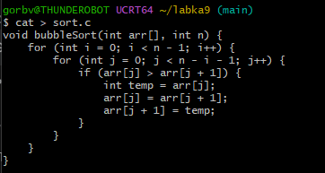
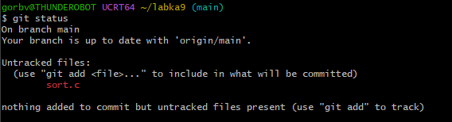
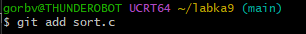
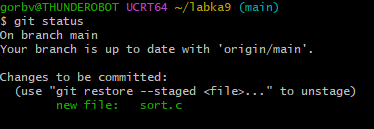
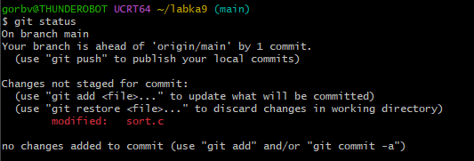
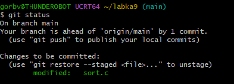
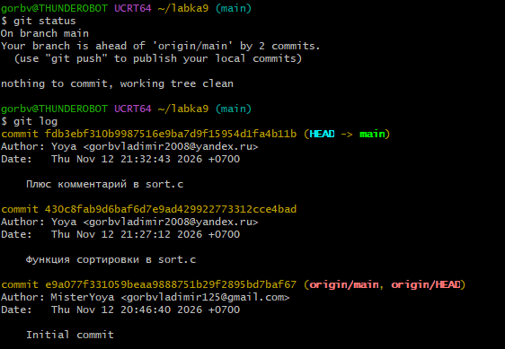
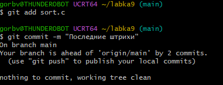
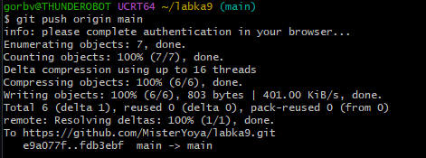

# labka9
this is the laba number nine and that's it

# Лабораторная работа № 9. Работа с Git и GitHub

Отчёт по девятой лабораторной работе (уровень на оценку «4»: основные команды Git, ветвление, просмотр изменений и их отмена, а также слияние веток). Вместо стандартной ветки `master` везде используется `main`.

## Задание на оценку «3». Основные команды Git

1. Перешёл в директорию `labka9` и проверил текущую ветку командой `git status` — активна ветка `main`, изменений нет (`working tree clean`).

2. Посмотрел историю коммитов командой `git log` — в журнале отображается только начальный коммит (`Initial commit`).

3. Создал файл `sort.c` в редакторе `nano` и добавил туда только функцию сортировки пузырьком (`bubbleSort`).

4. Проверил вывод `git status` — файл `sort.c` появился в разделе неотслеживаемых файлов (`Untracked files`).

5. Добавил файл в область `stage` (индекс) командой `git add sort.c`.

6. Снова проверил `git status` — теперь `sort.c` перешёл в список подготовленных к коммиту изменений (`Changes to be committed`).

7. Закоммитил файл в локальный репозиторий командой `git commit -m "Добавили ф-цию сортировки"`.

8. Проверил `git status` — рабочее дерево чистое, локальная ветка `main` опережает `origin/main` на 1 коммит.

9. Открыл `sort.c` и добавил в файл строку комментария.

10. Проверил `git status` — файл отображается как изменённый, но ещё не добавленный в индекс (`Changes not staged for commit`).

11. Проиндексировал изменение командой `git add sort.c`.

12. Проверил `git status` — обновлённый файл снова готов к коммиту (`Changes to be committed`).

13. Изменил файл `sort.c` ещё раз (подправил/убрал старый комментарий).

14. Сделал второй коммит командой `git commit`.

15. Проверил текущий статус (`git status`) и журнал коммитов (`git log`), в котором теперь отображается вся история изменений.

16. Добавил в `stage` последнее изменение (`git add sort.c`) и закоммитил его (`git commit`).

17. Отправил все локальные коммиты на удалённый репозиторий GitHub командой `git push origin main`.

