# labka9
this is the laba number nine and that's it

# Лабораторная работа № 9. Работа с Git и GitHub

Отчёт по девятой лабораторной работе (уровень на оценку «4»: основные команды Git, ветвление, просмотр изменений и их отмена, а также слияние веток). Вместо стандартной ветки `master` везде используется `main`.

## Задание на оценку «3». Основные команды Git

1. Перешёл в директорию `labka9` и проверил текущую ветку командой `git status` — активна ветка `main`, изменений нет (`working tree clean`).

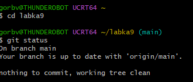

2. Посмотрел историю коммитов командой `git log` — в журнале отображается только начальный коммит (`Initial commit`).

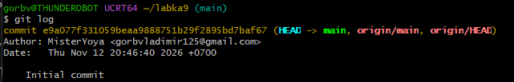

3. Создал файл `sort.c` в редакторе `nano` и добавил туда только функцию сортировки пузырьком (`bubbleSort`).

4. Проверил вывод `git status` — файл `sort.c` появился в разделе неотслеживаемых файлов (`Untracked files`).

[Проверка статуса](4.png)

5. Добавил файл в область `stage` (индекс) командой `git add sort.c`.

6. Снова проверил `git status` — теперь `sort.c` перешёл в список подготовленных к коммиту изменений (`Changes to be committed`).

7. Закоммитил файл в локальный репозиторий командой `git commit -m "Добавили ф-цию сортировки"`.

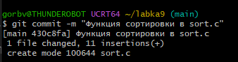

8. Проверил `git status` — рабочее дерево чистое, локальная ветка `main` опережает `origin/main` на 1 коммит.

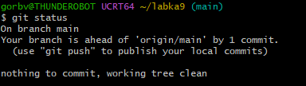

9. Открыл `sort.c` и добавил в файл строку комментария.

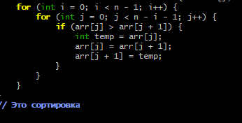

10. Проверил `git status` — файл отображается как изменённый, но ещё не добавленный в индекс (`Changes not staged for commit`).

11. Проиндексировал изменение командой `git add sort.c`.

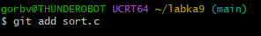

12. Проверил `git status` — обновлённый файл снова готов к коммиту (`Changes to be committed`).

13. Изменил файл `sort.c` ещё раз (подправил/убрал старый комментарий).

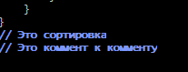

14. Сделал второй коммит командой `git commit`.

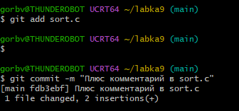

15. Проверил текущий статус (`git status`) и журнал коммитов (`git log`), в котором теперь отображается вся история изменений.

16. Добавил в `stage` последнее изменение (`git add sort.c`) и закоммитил его (`git commit`).

17. Отправил все локальные коммиты на удалённый репозиторий GitHub командой `git push origin main`.

## Задание на оценку «3» (часть 2). Работа с ветками (`mybranch`)

1. Создал новую ветку `mybranch` командой `git branch mybranch`.

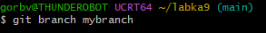

2. Проверил список веток командой `git branch` — в списке появились `main` и новая ветка `mybranch`.

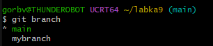

3. Переключился на ветку `mybranch` командой `git switch mybranch` (или `git checkout mybranch`).

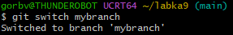

4. Проверил вывод `git status` — после переключения первая строка изменилась с `On branch main` на `On branch mybranch`.

Если в рабочей папке нет сохраненных изменений, вывод git status не изменится. Git просто поменяет указатель на текущую ветку.

5. Убедился через `git branch` / `git status`, что активна именно ветка `mybranch` (отмечена звёздочкой `*`).

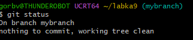

6. Создал в ветке `mybranch` файл `file1.txt` и записал в него своё имя.

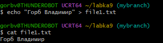

7. Добавил `file1.txt` в индекс (`git add file1.txt`) и закоммитил изменение (`git commit`).

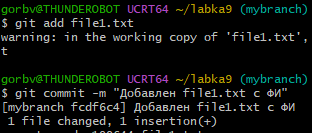

8. Проверил граф коммитов командой `git log --oneline --graph` — указатель ветки `mybranch` переместился на новый коммит с `file1.txt`.

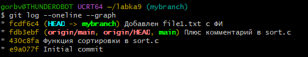

9. Вернулся обратно в основную ветку `main` командой `git switch main`.

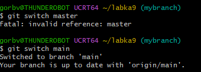

10. Выполнил `git log --oneline --graph` — в журнале исчез коммит из `mybranch`, так как текущая ветка `main` осталась на предыдущем коммите.

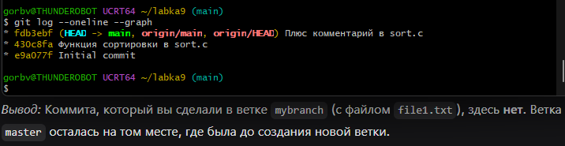

11. В ветке `main` создал новый файл `file2.txt`, добавил его в индекс и закоммитил.

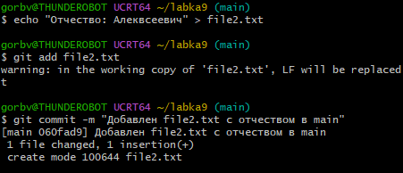

12. Запустил `git log --oneline --graph --all` — на графе видно расхождение веток: `main` указывает на коммит с `file2.txt`, а `mybranch` — на коммит с `file1.txt`.

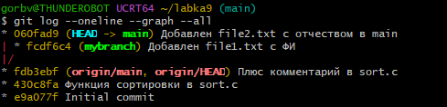

13. Снова переключился на ветку `mybranch` командой `git switch mybranch`.

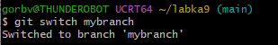

14. Проверил содержимое папки (`ls`) — файл `file2.txt` пропал из рабочего каталога, потому что он был создан и закоммичен только в ветке `main` (в `mybranch` остался только `file1.txt`).

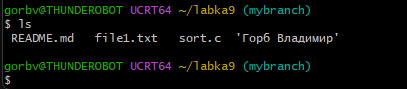
Да, file2.txt пропал, так как он был создан и закоммичен только в ветке master.

15. Сравнил ветки командой `git diff mybranch main` — Git показал разницу между ветками: удаление `file1.txt` и появление `file2.txt`.

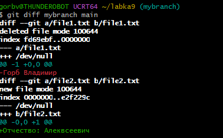

16. Закоммитил изменения в ветке `mybranch` и отправил её на удалённый репозиторий командой `git push -u origin mybranch`.

17. Проверил репозиторий на GitHub и убедился, что на сервере отображаются обе ветки (`main` и `mybranch`), а последние изменения из `main` также отправлены в `origin/main`.

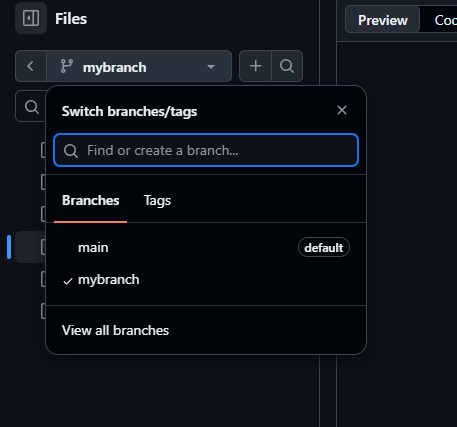